# Beyond the Factory Floor: Data Model & Schema Specification

## 1. Entity-Relationship Diagram (Mermaid ERD)

```mermaid
erDiagram
    MACHINES ||--o{ MACHINE_DEPENDENCIES : "upstream_of"
    MACHINES ||--o{ MACHINE_DEPENDENCIES : "downstream_of"
    MACHINES ||--o{ MACHINE_THRESHOLDS : "configures"
    MACHINES ||--o{ SENSOR_READINGS : "generates"
    MACHINES ||--o{ ANALYSIS_SNAPSHOTS : "analyzed_in"
    MACHINES ||--o{ COMPONENTS : "contains"
    MACHINES ||--o{ MAINTENANCE_RECORDS : "services"
    MACHINES ||--o{ PART_COMPATIBILITY : "compatible_with"
    MACHINES ||--o{ TECHNICIAN_QUALIFICATIONS : "requires"
    MACHINES ||--o{ ALERTS : "triggers"
    MACHINES ||--o{ MAINTENANCE_TASKS : "targets"
    MACHINES ||--o{ SIMULATION_RUNS : "simulates"

    COMPONENTS ||--o{ MAINTENANCE_RECORDS : "serviced_in"
    COMPONENTS ||--o{ PART_COMPATIBILITY : "uses_part"
    COMPONENTS ||--o{ MAINTENANCE_TASKS : "repaired_in"

    SPARE_PARTS ||--o{ PART_COMPATIBILITY : "supplies"
    SPARE_PARTS ||--o{ MAINTENANCE_TASKS : "allocated_to"
    SPARE_PARTS ||--o| SPARE_PARTS : "alternative_to"

    TECHNICIANS ||--o{ TECHNICIAN_QUALIFICATIONS : "holds"
    TECHNICIANS ||--o{ MAINTENANCE_RECORDS : "performed_by"
    TECHNICIANS ||--o{ MAINTENANCE_TASKS : "assigned_to"

    ALERTS ||--o{ ALERT_EVENTS : "transitions"
    ALERTS ||--o{ MAINTENANCE_TASKS : "initiates"

    MACHINES {
        string id PK
        string name
        string type
        string role_in_line
        integer nominal_throughput_uph
        float criticality_weight
        string model_url
        float pos_x
        float pos_y
        float pos_z
        float rot_y
        datetime created_at
    }

    MACHINE_DEPENDENCIES {
        integer id PK
        string upstream_id FK
        string downstream_id FK
        float propagation_factor
        string description
    }

    MACHINE_THRESHOLDS {
        integer id PK
        string machine_id FK
        string sensor
        string unit
        float normal_low
        float normal_high
        float warning
        float high
        float critical
        float weight
    }

    SENSOR_READINGS {
        bigint id PK
        string machine_id FK
        datetime ts
        float temperature_c
        float vibration_mm_s
        float current_a
        float pressure_bar
        float infrared_c
        float micro_movement_um
        float alignment_dev_mm
        float acoustic_db
        string scenario_tag
    }

    ANALYSIS_SNAPSHOTS {
        bigint id PK
        string machine_id FK
        datetime ts
        float health_score
        float risk_score
        string severity
        json reasons
        json anomalies
        json hypotheses
    }

    COMPONENTS {
        string id PK
        string machine_id FK
        string name
        date installed_on
        integer service_life_days
        date scheduled_replacement_on
        integer inspection_interval_days
        date last_inspected_on
        string condition
        string linked_sensor
    }

    MAINTENANCE_RECORDS {
        string id PK
        string machine_id FK
        string component_id FK
        datetime performed_on
        string type
        string summary
        string technician_id FK
    }

    SPARE_PARTS {
        string id PK
        string name
        integer quantity
        integer reorder_level
        integer lead_time_days
        string alternative_part_id FK
    }

    PART_COMPATIBILITY {
        integer id PK
        string part_id FK
        string machine_id FK
        string component_id FK
    }

    TECHNICIANS {
        string id PK
        string name
        string specialisation
        string availability
        string shift
        string current_task_id
    }

    TECHNICIAN_QUALIFICATIONS {
        integer id PK
        string technician_id FK
        string machine_id FK
        string machine_type
        integer level
    }

    ALERTS {
        string id PK
        string machine_id FK
        string root_cause_machine_id FK
        string severity
        string title
        string reason
        float risk_score
        string status
        datetime created_at
        datetime acknowledged_at
        string acknowledged_by
        datetime resolved_at
        string resolved_by
    }

    ALERT_EVENTS {
        integer id PK
        string alert_id FK
        datetime ts
        string event
        string from_severity
        string to_severity
        string actor
        string note
    }

    MAINTENANCE_TASKS {
        string id PK
        string machine_id FK
        string component_id FK
        string alert_id FK
        string priority
        string part_id FK
        string technician_id FK
        string status
        json rationale
        datetime created_at
        datetime completed_at
    }

    SIMULATION_RUNS {
        string id PK
        string machine_id FK
        string scenario
        datetime started_at
        datetime ended_at
        float speed
        string status
    }
```

---

## 2. Table Definitions & Specifications

### 2.1 `machines`
Primary registry of industrial equipment in the factory cell.

| Column | Type | Nullable | Description / Constraints |
|---|---|---|---|
| `id` | VARCHAR(16) | No | Primary Key. E.g. `MCH001`, `MCH002`, `MCH003`. |
| `name` | VARCHAR(64) | No | Human readable name. E.g. "Precision CNC Milling Centre". |
| `type` | VARCHAR(32) | No | Equipment category: `milling_centre`, `conveyor`, `packaging`. |
| `role_in_line` | VARCHAR(32) | No | Line position: `upstream`, `midstream`, `downstream`. |
| `nominal_throughput_uph` | INTEGER | No | Nominal units per hour capacity (e.g. 120 UPH). |
| `criticality_weight` | FLOAT | No | Relative importance in line (0.1 to 1.0, e.g. 0.95 for milling). |
| `model_url` | VARCHAR(255) | Yes | URL / path to 3D GLB asset (e.g. `/models/milling_centre.glb`). |
| `pos_x` | FLOAT | No | X coordinate on 3D floor in meters (e.g. -6.0). |
| `pos_y` | FLOAT | No | Y coordinate on 3D floor in meters (0.0 floor level). |
| `pos_z` | FLOAT | No | Z coordinate on 3D floor in meters (e.g. 0.0). |
| `rot_y` | FLOAT | No | Y rotation angle in radians (e.g. 0.0). |
| `created_at` | TIMESTAMP WITH TIME ZONE | No | Record creation timestamp. |

---

### 2.2 `machine_dependencies`
Directed links between machines establishing production line material flow.

| Column | Type | Nullable | Description / Constraints |
|---|---|---|---|
| `id` | SERIAL | No | Primary Key. |
| `upstream_id` | VARCHAR(16) | No | FK → `machines.id`. Source machine. |
| `downstream_id` | VARCHAR(16) | No | FK → `machines.id`. Dependent machine. |
| `propagation_factor` | FLOAT | No | Coupling factor (0.0 to 1.0, e.g. 0.85). |
| `description` | VARCHAR(255) | No | Human explanation of coupling (e.g. "Direct workpiece conveyance"). |

*Constraints:* `UNIQUE(upstream_id, downstream_id)`.

---

### 2.3 `machine_thresholds`
Sensor boundaries used for multi-level continuous grading.

| Column | Type | Nullable | Description / Constraints |
|---|---|---|---|
| `id` | SERIAL | No | Primary Key. |
| `machine_id` | VARCHAR(16) | No | FK → `machines.id`. |
| `sensor` | VARCHAR(32) | No | Identifier: `temperature_c`, `vibration_mm_s`, `current_a`, etc. |
| `unit` | VARCHAR(16) | No | Physical unit: `°C`, `mm/s`, `A`, `bar`, `µm`, `mm`, `dB`. |
| `normal_low` | FLOAT | No | Baseline low operating boundary. |
| `normal_high` | FLOAT | No | Baseline high operating boundary. |
| `warning` | FLOAT | No | Warning boundary (initial derate). |
| `high` | FLOAT | No | High threshold (significant penalty). |
| `critical` | FLOAT | No | Critical threshold (severe failure risk). |
| `weight` | FLOAT | No | Relative penalty weight (0.5 to 2.5). |

*Indexes:* `CREATE INDEX idx_machine_thresholds_lookup ON machine_thresholds(machine_id, sensor);`

---

### 2.4 `sensor_readings`
High frequency telemetry log recorded at 1 second intervals.

| Column | Type | Nullable | Description / Constraints |
|---|---|---|---|
| `id` | BIGSERIAL | No | Primary Key. |
| `machine_id` | VARCHAR(16) | No | FK → `machines.id`. |
| `ts` | TIMESTAMP WITH TIME ZONE | No | Telemetry timestamp (UTC). |
| `temperature_c` | FLOAT | No | Spindle/motor temperature in °C. |
| `vibration_mm_s` | FLOAT | No | Vibration RMS in mm/s. |
| `current_a` | FLOAT | No | Electrical current draw in Amperes. |
| `pressure_bar` | FLOAT | No | Hydraulic/pneumatic pressure in bar. |
| `infrared_c` | FLOAT | No | Infrared thermal hotspot in °C. |
| `micro_movement_um` | FLOAT | No | Structural micro-displacement in micrometers. |
| `alignment_dev_mm` | FLOAT | No | Shaft alignment deviation in millimeters. |
| `acoustic_db` | FLOAT | No | Acoustic noise emission in decibels. |
| `scenario_tag` | VARCHAR(64) | Yes | Active simulation tag if generated during scenario. |

*Indexes & Retention:*
- `CREATE INDEX idx_sensor_readings_machine_ts ON sensor_readings(machine_id, ts DESC);`
- Retained for `READING_RETENTION_MINUTES` (default 120 minutes). Pruned periodically via ingest worker.

---

### 2.5 `analysis_snapshots`
Computed intelligence evaluation recorded per telemetry tick.

| Column | Type | Nullable | Description / Constraints |
|---|---|---|---|
| `id` | BIGSERIAL | No | Primary Key. |
| `machine_id` | VARCHAR(16) | No | FK → `machines.id`. |
| `ts` | TIMESTAMP WITH TIME ZONE | No | Computation timestamp. |
| `health_score` | FLOAT | No | Health Score (0.0 to 100.0). |
| `risk_score` | FLOAT | No | Risk Score (0.0 to 100.0). |
| `severity` | VARCHAR(16) | No | `Normal`, `Warning`, `High`, `Critical`, `Emergency`. |
| `reasons` | JSONB | No | Array of penalty reasons `[{ factor, observed, limit, points, note }]`. |
| `anomalies` | JSONB | No | Array of active sensor anomalies with z-scores / deviations. |
| `hypotheses` | JSONB | No | Array of matched pattern rules `[{ hypothesis, matched, total, note }]`. |

*Indexes:* `CREATE INDEX idx_analysis_snapshots_machine_ts ON analysis_snapshots(machine_id, ts DESC);`

---

### 2.6 `components`
Major physical subassemblies tracked for lifecycle and predictive maintenance.

| Column | Type | Nullable | Description / Constraints |
|---|---|---|---|
| `id` | VARCHAR(32) | No | Primary Key. E.g. `CMP001_SPINDLE_BEARING`. |
| `machine_id` | VARCHAR(16) | No | FK → `machines.id`. |
| `name` | VARCHAR(64) | No | Component name: "High Speed Spindle Bearings". |
| `installed_on` | DATE | No | Date installed in machine. |
| `service_life_days` | INTEGER | No | Nominal rated life expectancy in days. |
| `scheduled_replacement_on`| DATE | No | Target calendar replacement date. |
| `inspection_interval_days`| INTEGER | No | Recommended inspection frequency in days. |
| `last_inspected_on` | DATE | No | Most recent physical inspection date. |
| `condition` | VARCHAR(16) | No | `Good`, `Fair`, `Degraded`, `Critical`. |
| `linked_sensor` | VARCHAR(32) | No | Sensor signature linked to this part (e.g. `vibration_mm_s`). |

---

### 2.7 `maintenance_records`
Historical log of past interventions, inspections, and repairs.

| Column | Type | Nullable | Description / Constraints |
|---|---|---|---|
| `id` | VARCHAR(32) | No | Primary Key. E.g. `REC001`. |
| `machine_id` | VARCHAR(16) | No | FK → `machines.id`. |
| `component_id` | VARCHAR(32) | Yes | FK → `components.id`. |
| `performed_on` | TIMESTAMP WITH TIME ZONE | No | Execution timestamp. |
| `type` | VARCHAR(32) | No | `Inspection`, `Preventive`, `Corrective`, `Emergency`. |
| `summary` | TEXT | No | Technical summary of work performed. |
| `technician_id` | VARCHAR(16) | No | FK → `technicians.id`. |

---

### 2.8 `spare_parts`
Inventory catalog of replacement parts, quantities, and lead times.

| Column | Type | Nullable | Description / Constraints |
|---|---|---|---|
| `id` | VARCHAR(32) | No | Primary Key. E.g. `SP001_BEARING_SET`. |
| `name` | VARCHAR(64) | No | Part description: "SKF 7205 Precision Angular Contact Bearing Set". |
| `quantity` | INTEGER | No | Current on-hand stock count. |
| `reorder_level` | INTEGER | No | Minimum safety threshold triggering reorder flag. |
| `lead_time_days` | INTEGER | No | Supplier delivery time in business days. |
| `alternative_part_id`| VARCHAR(32) | Yes | FK → `spare_parts.id`. Compatible substitute part. |

---

### 2.9 `part_compatibility`
Mapping of spare parts to machines and specific components.

| Column | Type | Nullable | Description / Constraints |
|---|---|---|---|
| `id` | SERIAL | No | Primary Key. |
| `part_id` | VARCHAR(32) | No | FK → `spare_parts.id`. |
| `machine_id` | VARCHAR(16) | No | FK → `machines.id`. |
| `component_id` | VARCHAR(32) | Yes | FK → `components.id`. |

*Constraints:* `UNIQUE(part_id, machine_id, component_id)`.

---

### 2.10 `technicians`
Personnel roster of factory maintenance technicians.

| Column | Type | Nullable | Description / Constraints |
|---|---|---|---|
| `id` | VARCHAR(16) | No | Primary Key. E.g. `TCH001`, `TCH002`. |
| `name` | VARCHAR(64) | No | Full technician name: "Meera Iyer". |
| `specialisation` | VARCHAR(32) | No | `Mechanical`, `Electrical`, `Mechatronics`, `Automation`. |
| `availability` | VARCHAR(16) | No | `Available`, `On Duty`, `Unavailable`, `Off Shift`. |
| `shift` | VARCHAR(16) | No | `Morning`, `Evening`, `Night`. |
| `current_task_id` | VARCHAR(32) | Yes | Active maintenance work order ID if assigned. |

---

### 2.11 `technician_qualifications`
Certified capability levels of technicians on specific machines or machine types.

| Column | Type | Nullable | Description / Constraints |
|---|---|---|---|
| `id` | SERIAL | No | Primary Key. |
| `technician_id` | VARCHAR(16) | No | FK → `technicians.id`. |
| `machine_id` | VARCHAR(16) | Yes | FK → `machines.id` (if machine specific). |
| `machine_type` | VARCHAR(32) | Yes | Target machine type (e.g. `milling_centre`). |
| `level` | INTEGER | No | Certification tier: 1 (Basic), 2 (Advanced), 3 (Master Specialist). |

---

### 2.12 `alerts`
Persistent incidents escalated from continuous anomaly detection.

| Column | Type | Nullable | Description / Constraints |
|---|---|---|---|
| `id` | VARCHAR(32) | No | Primary Key. E.g. `ALR0042`. |
| `machine_id` | VARCHAR(16) | No | FK → `machines.id`. Originating machine. |
| `root_cause_machine_id`| VARCHAR(16) | No | FK → `machines.id`. Isolated root cause machine. |
| `severity` | VARCHAR(16) | No | `Warning`, `High`, `Critical`, `Emergency`. |
| `title` | VARCHAR(128) | No | Incident headline: "Rapid Spindle Bearing Thermal Rise". |
| `reason` | TEXT | No | Full diagnostic explanation with conditions matched. |
| `risk_score` | FLOAT | No | Risk score at time of alert escalation. |
| `status` | VARCHAR(16) | No | `active`, `acknowledged`, `resolved`. |
| `created_at` | TIMESTAMP WITH TIME ZONE | No | Alert inception timestamp. |
| `acknowledged_at` | TIMESTAMP WITH TIME ZONE | Yes | Acknowledgment timestamp. |
| `acknowledged_by` | VARCHAR(64) | Yes | User / operator who acknowledged. |
| `resolved_at` | TIMESTAMP WITH TIME ZONE | Yes | Resolution timestamp. |
| `resolved_by` | VARCHAR(64) | Yes | Supervisor who resolved. |

---

### 2.13 `alert_events`
Immutable audit log recording every severity change, acknowledgment, and resolution.

| Column | Type | Nullable | Description / Constraints |
|---|---|---|---|
| `id` | SERIAL | No | Primary Key. |
| `alert_id` | VARCHAR(32) | No | FK → `alerts.id`. |
| `ts` | TIMESTAMP WITH TIME ZONE | No | Transition timestamp. |
| `event` | VARCHAR(32) | No | `created`, `escalated`, `acknowledged`, `deescalated`, `resolved`. |
| `from_severity` | VARCHAR(16) | Yes | Severity prior to event. |
| `to_severity` | VARCHAR(16) | No | Severity after event. |
| `actor` | VARCHAR(64) | No | User identifier or `system_engine`. |
| `note` | TEXT | Yes | Contextual transition commentary. |

---

### 2.14 `maintenance_tasks`
Actionable work orders generated by the recommendation engine.

| Column | Type | Nullable | Description / Constraints |
|---|---|---|---|
| `id` | VARCHAR(32) | No | Primary Key. E.g. `TSK0101`. |
| `machine_id` | VARCHAR(16) | No | FK → `machines.id`. |
| `component_id` | VARCHAR(32) | No | FK → `components.id`. |
| `alert_id` | VARCHAR(32) | Yes | FK → `alerts.id`. |
| `priority` | VARCHAR(16) | No | `Low`, `Medium`, `High`, `Urgent`. |
| `part_id` | VARCHAR(32) | Yes | FK → `spare_parts.id`. |
| `technician_id` | VARCHAR(16) | Yes | FK → `technicians.id`. |
| `status` | VARCHAR(16) | No | `proposed`, `approved`, `in_progress`, `completed`, `cancelled`. |
| `rationale` | JSONB | No | Full explainable `why` breakdown `[{ factor, justification }]`. |
| `created_at` | TIMESTAMP WITH TIME ZONE | No | Inception timestamp. |
| `completed_at` | TIMESTAMP WITH TIME ZONE | Yes | Work completion timestamp. |

---

### 2.15 `simulation_runs`
Audit trail of failure scenarios and abnormal events executed in the sandbox.

| Column | Type | Nullable | Description / Constraints |
|---|---|---|---|
| `id` | VARCHAR(32) | No | Primary Key. E.g. `SIM001`. |
| `machine_id` | VARCHAR(16) | No | FK → `machines.id`. Target machine. |
| `scenario` | VARCHAR(64) | No | Scenario identifier: `motor_overheating`, `bearing_wear`, etc. |
| `started_at` | TIMESTAMP WITH TIME ZONE | No | Scenario trigger time. |
| `ended_at` | TIMESTAMP WITH TIME ZONE | Yes | Scenario completion or reset time. |
| `speed` | FLOAT | No | Speed multiplier: 1.0, 2.0, 5.0. |
| `status` | VARCHAR(16) | No | `running`, `completed`, `reset`. |

---

## 3. Idempotent Seed Strategy

The seeding engine (`backend/app/seed/seed.py`) implements deterministic idempotent upserts:
1. All seed records have explicit primary keys (`MCH001`, `CMP001_BEARING`, `SP001_BEARING_SET`, `TCH001`).
2. Operations use `session.merge()` or `INSERT ... ON CONFLICT (id) DO UPDATE`.
3. Running `python -m app.seed.seed` multiple times never duplicates rows and guarantees identical baseline states.
